<p align="center">
  
</p>

# 🎬 Awesome 3D Animation & Motion Retargeting [](https://awesome.re)

> 🚀 A curated list of top tools, AI models, libraries, and SaaS platforms for **3D character animation**, **markerless motion capture (mocap)**, **skeletal auto-rigging**, and **motion retargeting** across Blender, Unreal Engine, Unity, and Godot.

<p align="center">
  <a href="https://github.com/ishandutta2007/Awesome-Awesome-Awesome"></a><a href="https://discord.gg/jc4xtF58Ve"></a>
  <a href="https://github.com/ishandutta2007/Awesome-3D-Animation-Motion-Retargeting/stargazers"></a>
  <a href="https://github.com/ishandutta2007/Awesome-3D-Animation-Motion-Retargeting/network/members"></a>
  <a href="https://github.com/ishandutta2007/Awesome-3D-Animation-Motion-Retargeting/blob/main/README.md#contributing"></a>
  <a href="https://creativecommons.org/publicdomain/zero/1.0/"></a>
  <a href="https://github.com/ishandutta2007"></a>
</p>

---

## 🧭 Table of Contents

- [🌐 Overview](#-overview)
- [📈 Sector Overview & Market Dynamics](#-sector-overview--market-dynamics)
- [☁️ SaaS & Hosted Platforms](#️-saas--hosted-platforms)
- [💻 Open-Source GitHub Projects](#-open-source-github-projects)
  - [⭐ All Open-Source Repositories (Ranked by Stars)](#-all-open-source-repositories-ranked-by-stars)
- [🛠️ Recommended Production Pipelines](#️-recommended-production-pipelines)
- [🤝 Contributing](#-contributing)
- [💖 Support](#-support)
- [📊 Star History](#-star-history)
- [⚖️ Disclaimer & Licensing Notice](#️-disclaimer--licensing-notice)

---

## 🌐 Overview

This repository tracks the leading **open-source software** and **SaaS platforms** for **3D animation and skeletal motion retargeting**. Whether you are building an indie game, producing VTuber animations, or developing next-generation VFX pipelines, these tools extract humanoid and quadruped motion from video, sensors, or text prompts, retarget animations between disparate skeletal rigs (Mixamo, Rigify, UE5 Mannequin, VRM, SMPL-X), and export clean, production-ready assets.

### 🎯 Key Focus Areas & Keywords
- 📹 **Video-to-Motion Capture (Mocap):** Markerless single and multi-camera tracking using computer vision and deep learning.
- 🦴 **Skeletal Auto-Rigging:** Automatic bone placement, weighting, and skinning for humanoid and non-humanoid meshes.
- 🔄 **Motion Retargeting:** Cross-skeleton animation mapping (e.g., Mixamo to Unreal Engine 5 or Blender Rigify).
- 🧠 **Text-to-Motion Synthesis:** Generative AI diffusion models producing 3D skeletal animations from natural language prompts.
- ⚙️ **Physics-Assisted Animation:** Trajectory optimization, secondary motion simulation, and foot contact stabilization.

---

## 📈 Sector Overview & Market Dynamics

The global 3D animation and motion capture market is estimated at **$24B–$32B** for 3D animation software/digital pipelines (projected to reach over **$36B by 2026** at ~11% CAGR), alongside a dedicated 3D motion capture sector expanding from **$280M toward $550M** as computer vision replaces costly sensor suits.

The sector is **moderately fragmented**: incumbent CAD/creative giants (**Adobe** and **Autodesk**) anchor industry standards in foundational rigging and VFX workflows, while a fast-moving, competitive tier of venture-backed startups and open-source models compete fiercely in markerless video AI, real-time pose estimation, and generative text-to-motion—preventing a single winner-take-all monopoly.

---

## ☁️ SaaS & Hosted Platforms

The following hosted solutions provide cloud-based AI motion capture, automated rigging, character emote generation, and cloud retargeting libraries. 

*(Sorted descending by company valuation / market size)*

| Platform | Valuation / Market Size | Primary Focus & Capabilities | Pricing Model (Specific Tiers) | Free Tier Limits |
| :--- | :--- | :--- | :--- | :--- |
| **[Adobe Mixamo](https://mixamo.com)** | **~$150B Market Cap** *(Parent: Adobe Inc.)* | Automatic humanoid auto-rigging and royalty-free mocap animation library. | **$0.00 / month** (100% Free) | **Unlimited free forever**: Full character rigging and animation downloads for commercial & personal projects with a free Adobe ID. |
| **[Autodesk Flow Studio](https://wonderdynamics.com)** | **~$63B Market Cap** *(Parent: Autodesk Inc.)* | Cloud AI VFX tool replacing actors in live-action footage with rigged 3D CG characters. | **Lite tier starts at $9.99/mo** (or $84/yr); Pro tier at $89.00/mo. | **Free tier available**: 300 free monthly credits, limited to 720p watermarked video exports and 5 GB storage. |
| **[DeepMotion](https://deepmotion.com)** | **~$77M Acquisition / Valuation** *(Acquired by Xiaomi)* | Cloud AI markerless mocap from standard 2D video (full-body, hands, face, and physics). | **Starter plan starts at $15.00/mo**; Innovator at $42.00/mo; Professional at $83.00/mo. | **Free tier available**: 60 free animation credits per month (~60 sec of tracking), non-commercial use only. |
| **[Rokoko Studio](https://rokoko.com)** | **~$80M Valuation** *(Series A Venture-backed)* | Hardware mocap recording, smart suit integration, and Rokoko Vision AI video tracking. | **Basic (AI) tier starts at $20.00/seat/mo**; Plus tier at $50.00/seat/mo. | **Free Starter plan ($0/mo forever)**: Unlimited .FBX and .BVH motion recordings/exports and 30 seconds/month of Rokoko Vision AI capture. |
| **[Cascadeur](https://cascadeur.com)** | **~$30M–$50M Est. Product Valuation** *(Backed by Nekki)* | Standalone physics-assisted 3D keyframe animation software with AutoPosing and trajectory control. | **Indie tier starts at $19.00/mo** (or $99.00/year); Pro tier at $49.00/mo ($399.00/year). | **Free plan ($0 forever)**: Complete access to keyframing, AutoPosing, and physics tools with basic non-commercial export constraints. |
| **[Reallusion ActorCore](https://reallusion.com)** | **~$10M Market Cap** *(TPEX: 6882 / Reallusion Inc.)* | AAA mocap animations, AccuRIG auto-rigging tool, and multi-format retargeting. | **Flex Subscription starts at $29.00/mo**; individual asset packs from $5.00 to $99.00. | **Free forever section**: Includes 3 permanent free 3D characters, ~32 free mocap animations, and free unlimited access to AccuRIG auto-rigging desktop app. |
| **[Anything World](https://anything.world)** | **~$15M–$20M Est. Valuation** *($7.5M Seed+ raised)* | AI-driven 3D model generation, automated rigging, and runtime character animation. | **Nano plan starts at $30.00/mo** (100 credits); Micro plan at $60.00/mo (300 credits). | **Free Individual plan ($0/mo forever)**: Includes 15-20 monthly credits (~3-4 auto-rig/animate runs) for students and personal hobbyist testing. |
| **[Kinetix](https://kinetix.tech)** | **~$12M Funding Raised** *(Paris AI 3D Studio)* | Generative AI 3D emote SDK and developer integrations for virtual worlds and games. | **Developer SDK tier starts at $49.00/mo**; custom enterprise contracts for game integration. | **14-day free trial**: Access to cloud emote generation sandbox with up to 100 API test calls during trial. |
| **[Plask](https://plask.ai)** | **~$8M–$12M Est. Valuation** *($2.56M Pre-Series A)* | Browser-based AI motion capture, 3D keyframe cleanup, and bone retargeting editor. | **Standard plan starts at $18.00/mo**; Pro plan at $50.00/mo. | **Free plan ($0/mo forever)**: 15 seconds of free AI video motion capture per day and 1 GB cloud storage. |
| **[Move.ai](https://move.ai)** | **~$1.5M Asset Valuation** *(Acquired by Oxford Metrics)* | Single-camera (Move One iOS) and multi-camera studio markerless AI mocap. | **Move One Personal starts at $15.00/mo** (billed annually at $180/yr) or $30.00/mo flexible. | **Free Starter trial on Move One iOS**: 3 free export credits (up to 30 seconds of tracked mocap) to test single-camera iOS tracking. |

---

## 💻 Open-Source GitHub Projects

### ⭐ All Open-Source Repositories (Ranked by Stars)

The table below lists all top open-source projects for 3D animation, markerless mocap, pose estimation, and skeletal motion retargeting, ordered in descending order of GitHub community stars:

| Repository | Stars Badge | License | Description & Target Architecture |
| :--- | :--- | :--- | :--- |
| **[Godot Engine](https://github.com/godotengine/godot)** | [](https://github.com/godotengine/godot/stargazers) | `MIT` | Multi-platform 2D/3D game engine featuring runtime `SkeletonProfileHumanoid` animation retargeting and bone remapping. |
| **[OpenPose (CMU)](https://github.com/CMU-Perceptual-Computing-Lab/openpose)** | [](https://github.com/CMU-Perceptual-Computing-Lab/openpose/stargazers) | `Non-Commercial` | Landmark multi-person 2D/3D keypoint detection library estimating body, face, hands, and foot coordinates from images and video. |
| **[Blender](https://github.com/blender/blender)** | [](https://github.com/blender/blender/stargazers) | `GPL-2.0+` | Comprehensive open-source 3D creation suite featuring Rigify auto-rigging, NLA editor, bone constraints, and custom retargeters. |
| **[FreeMoCap](https://github.com/freemocap/freemocap)** | [](https://github.com/freemocap/freemocap/stargazers) | `AGPL-3.0` | Free, hardware-agnostic markerless motion capture system for multi-camera consumer hardware and spatial 3D tracking. |
| **[OpenFace](https://github.com/TadasBaltrusaitis/OpenFace)** | [](https://github.com/TadasBaltrusaitis/OpenFace/stargazers) | `Research / Educational` | State-of-the-art computer vision toolkit for facial landmark detection, head pose estimation, eye-gaze tracking, and facial action unit recognition. |
| **[Kimodo (NVIDIA)](https://github.com/nv-tlabs/kimodo)** | [](https://github.com/nv-tlabs/kimodo/stargazers) | `Apache-2.0` | Kinematic motion diffusion model for high-quality human and humanoid robot motion generation and cross-embodiment retargeting. |
| **[Human Motion Diffusion Model (MDM)](https://github.com/GuyTevet/motion-diffusion-model)** | [](https://github.com/GuyTevet/motion-diffusion-model/stargazers) | `MIT` | Foundational PyTorch generative diffusion model synthesizing diverse, realistic 3D human motion sequences from natural language prompts. |
| **[SysMocap](https://github.com/xianfei/SysMocap)** | [](https://github.com/xianfei/SysMocap/stargazers) | `MPL-2.0` | Real-time webcam motion capture system retargeting live actor kinematics directly onto 3D virtual avatars (VRM, Live2D). |
| **[SMPL-X](https://github.com/vchoutas/smplx)** | [](https://github.com/vchoutas/smplx/stargazers) | `SMPL-X License` | Expressive 3D parametric human body model incorporating simultaneous body pose, facial expressions, and articulated hand gestures. |
| **[OpenSeeFace](https://github.com/emilianavt/OpenSeeFace)** | [](https://github.com/emilianavt/OpenSeeFace/stargazers) | `BSD-2-Clause` | Robust, lightweight real-time facial and eye-gaze tracking on CPU with instant streaming to Blender, Unity, and VSeeFace over UDP. |
| **[Motion2MixamoRig](https://github.com/MaxLiu22/Motion2MixamoRig)** | [](https://github.com/MaxLiu22/Motion2MixamoRig/stargazers) | `Apache-2.0` | AI-assisted tool and Blender add-on extracting human motion from video or photo inputs and retargeting onto Adobe Mixamo character rigs. |
| **[VRM Add-on for Blender](https://github.com/saturday06/VRM-Addon-for-Blender)** | [](https://github.com/saturday06/VRM-Addon-for-Blender/stargazers) | `MIT` | Full VRM format pipeline inside Blender supporting humanoid bone mapping, spring bones, blendshapes, and avatar export. |
| **[ThreeDPoseTracker](https://github.com/digital-standard/ThreeDPoseTracker)** | [](https://github.com/digital-standard/ThreeDPoseTracker/stargazers) | `Commercial / Free evaluation` | Real-time AI 3D pose estimation from a single RGB webcam, streaming skeletal rotations to Unity avatars via VMC protocol. |
| **[MotionDiffuse](https://github.com/MotrixLab/MotionDiffuse)** | [](https://github.com/MotrixLab/MotionDiffuse/stargazers) | `Academic / Open` | Diffusion-based text-driven 3D human motion generation framework with fine-grained multi-joint and body part control. |
| **[Pose2Sim](https://github.com/perfanalytics/pose2sim)** | [](https://github.com/perfanalytics/pose2sim/stargazers) | `BSD-3-Clause` | Markerless kinematics software pipeline calculating 3D OpenSim biomechanical motion from calibrated 2D video feeds. |
| **[NVIDIA SOMA Retargeter](https://github.com/NVIDIA/soma-retargeter)** | [](https://github.com/NVIDIA/soma-retargeter/stargazers) | `Apache-2.0` | High-performance BVH to humanoid robot motion retargeting library built on Newton and NVIDIA Warp with contact stabilization. |
| **[fairmotion (Meta)](https://github.com/facebookresearch/fairmotion)** | [](https://github.com/facebookresearch/fairmotion/stargazers) | `MIT / Open` | Research library by Meta for loading, converting, processing, visualising, and training deep learning models on mocap datasets. |
| **[Rokoko Studio Live for Blender](https://github.com/Rokoko/rokoko-studio-live-blender)** | [](https://github.com/Rokoko/rokoko-studio-live-blender/stargazers) | `LGPL-3.0` | Live motion capture data streaming and custom skeletal bone-mapping add-on for Blender viewports. |
| **[OpenCap Core](https://github.com/opencap-org/opencap-core)** | [](https://github.com/opencap-org/opencap-core/stargazers) | `Apache-2.0` | Stanford-developed markerless motion capture engine computing 3D kinematics and joint torques using multi-smartphone video capture. |
| **[Open Mocap for Blender](https://github.com/Larenju-Rai/open-mocap-blender)** | [](https://github.com/Larenju-Rai/open-mocap-blender/stargazers) | `MIT` | MediaPipe and OpenCV powered offline full-body and hand tracking Blender add-on with direct bone retargeting to custom rigs. |
| **[BlendCap](https://github.com/Arcomade/BlendCap)** | [](https://github.com/Arcomade/BlendCap/stargazers) | `GPL-3.0` | Single-video performance capture add-on for Blender with body, hand, and face tracking, foot grounding cleanup, and Rigify support. |
| **[toyxyz Blender Retargeter](https://github.com/toyxyz/toyxyz-blender-retargeter)** | [](https://github.com/toyxyz/toyxyz-blender-retargeter/stargazers) | `GPL-3.0` | Live humanoid animation retargeting tool for Blender featuring automated bone matching, reference pose presets, and foot pinning. |
| **[blender_mocap (ioxandrii)](https://github.com/ioxandrii/blender_mocap)** | [](https://github.com/ioxandrii/blender_mocap/stargazers) | `MIT` | Lightweight Blender CLI utility script for batch retargeting BVH motion files onto Mixamo-style FBX armatures. |

---

## 🛠️ Recommended Production Pipelines

| Goal | Recommended Workflow Stack |
| :--- | :--- |
| **Solo Indie Game Dev** | Video clip ➔ **BlendCap** or **DeepMotion** ➔ Blender (Clean up with **toyxyz-blender-retargeter**) ➔ Export FBX/GLTF to **Godot 4** or **Unity** |
| **Mixamo Rig Compatibility** | Video / Image ➔ **Motion2MixamoRig** ➔ Batch apply to Mixamo characters with **blender_mocap** |
| **High-Precision Multi-Camera Studio** | Synchronized cameras / smartphones ➔ **FreeMoCap** or **Move.ai** ➔ Blender Rigify / UE5 IK Retargeter |
| **Generative Animation from Text** | Natural language prompt ➔ **Motion Diffusion Model (MDM)** or **MotionDiffuse** ➔ SMPL-X / BVH ➔ Unreal Engine 5 or Blender NLA |
| **Live VTuber / Streaming** | Standard Webcam ➔ **OpenSeeFace** + **SysMocap** / **ThreeDPoseTracker** ➔ OBS Studio virtual camera |

---

## 🤝 Contributing

Contributions are warmly welcomed! To suggest a tool, add a new library, or fix an outdated entry:

1. **Fork** this repository.
2. Create a new branch (`git checkout -b feature/add-new-tool`).
3. Add the project under the appropriate section following the existing format:
   ```markdown
   - **[Project Name](https://github.com/username/project)** - Descriptive 1-2 sentence overview (`License`).
   ```
4. If adding a SaaS product, please update the [SaaS & Hosted Platforms table](#️-saas--hosted-platforms) with company valuation, specific starting tier pricing, and explicit free tier limits.
5. Commit your changes and open a **Pull Request**.

---

## 💖 Support

Thank you for exploring and supporting the **Awesome 3D Animation & Motion Retargeting** ecosystem! 🌟

If you find this repository helpful for your projects, games, or research, please consider:
- ⭐ **Starring** the repository on GitHub to help others discover it.
- 🍴 **Forking** and contributing your favorite tools or pipeline improvements.
- 📢 **Sharing** this resource with technical artists, game developers, and animators.
- ☕ **Sponsoring / Buying a Coffee:** Support ongoing maintenance and curated updates via the [GitHub Sponsor Dashboard](https://github.com/sponsors/ishandutta2007).

---

## 📊 Star History

[](https://www.star-history.com/#ishandutta2007/Awesome-3D-Animation-Motion-Retargeting&type=date&legend=top-left)

---

## ⚖️ Disclaimer & Licensing Notice

- This curated list is maintained for educational, research, and technical animation purposes.
- Some open-source AI mocap tools utilize academic models (such as SMPL, SMPL-X, or MANO) which carry non-commercial research licensing terms. Always verify model licenses prior to commercial game or film release.
- Self-hosted deep learning mocap models typically require hardware acceleration (NVIDIA CUDA, AMD ROCm, or Apple Metal) for real-time inference.
